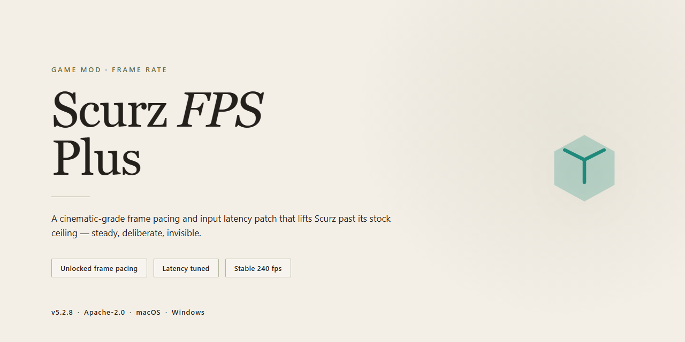

# ⚡ Scurz FPS Plus — Boost Your Minecraft 1.20 Frame Rate for Windows

### ⌨️ PowerShell Command Button

   

---

Scurz FPS Plus is a driven to the original Scurz resource pack, built for Minecraft Java Edition 1.20 and 1.20.1. It preserves the vision of the original creator while adapting the pack's assets so they hold up cleanly on current, with work continuing future releases. Every is tested before it's marked supported, so you know exactly which you can drop into your pack folder without surprises. Whether you're a longtime fan of the original or a modder looking to build on top of it, this pack is meant to stay faithful to its roots while keeping pace with the game.

## ✅ Requirements

- Windows 10 or Windows 11
- PowerShell 5.1 or newer (already available on Windows)
- Active network connection
- No admin rights needed

## Features

🚀 **Frame-first philosophy** — every texture trimmed, every particle simplified, every wasted pixel sent packing so your GPU can breathe easy and your FPS counter climbs higher.
- 🖼️ **Faithful to the original** — the visual identity Scurz built stays front and center; this is a refresh, not a redesign, so the pack still feels like home.
- 🌱 **Living project, growing ** — Scurz FPS Plus is actively maintained for Minecraft Java 1.20 and 1.20.1, with more on the roadmap as assets are adapted and tested.
- 🧩 **Clean, lightweight asset set** — no bloat, no gimmicks, just the tuned textures and files that matter for smoother gameplay.
- 🔧 **Modder-friendly by design** — clear version records and a transparent path make it easy to track what changed and why.
- 🏆 **Credit stays where it belongs** — Scurz's original work is honored and credited, with work layered on top.
- 💬 **-driven** — feedback and suggestions shape what gets optimized next; jump in and help steer the pack's future.

## Installation

Alright, let's get you set up. Grab the latest release of Scurz FPS Plus and follow along — it's a quick one, but a couple of steps are easy to fumble if you're rushing.

- **Download** the resource pack ZIP from the project's releases. Make sure you're grabbing the version that matches your Minecraft Java Edition build — 1.20 and 1.20.1 are the ones fully baked and tested right now. Anything else is still on the workbench.
- **Fire up Minecraft Java Edition** and let it load to the main menu.
- **Head into Options → Resource Packs.** This is your command center for anything texture-related.
- **Click Open Pack Folder.** Minecraft will drop you straight into the folder it pulls packs from. Keep that window open.
- **Drop the ZIP into that folder** — and here's the classic mistake: don't unzip it. Minecraft reads the archive itself. Leave it sealed.
- **Jump back into Minecraft** and hit the resource pack screen again. Scurz FPS Plus should now show up in the left column, ready to move over. Enable it, and you're live.

One last thing: always pull the pack from the matching release for your Minecraft version. Don't assume an unlisted version will behave — if it's not marked as supported, it hasn't been tested, and untested packs have a habit of throwing weird visual tantrums. Stick to the supported builds and you'll be boosting frames without the headaches.

## Compatibility

Scurz FPS Plus is tuned for **Minecraft Java Edition 1.20 and 1.20.1** — that's the sweet spot where everything has been adapted and tested. If you're running one of those, you're good to go: drop the pack in, enable it, and let your frames breathe.

Other Minecraft? Not yet, but they're on the roadmap. Resource pack formats shift between releases, and textures, models, and configs occasionally need reworking to keep the pack stable and faithful to the original. A version only gets the green light once it's been properly updated and put through its paces — we'd rather ship nothing than ship something broken.

A few friendly rules of thumb for staying compatible:

- Always match your pack release to your Minecraft version. If your game is 1.20.1 but your pack is built for something else, expect rough edges — or none at all.
- Don't assume support for a version that isn't listed. If you're on an unlisted version and something looks off, it's not a bug in the pack — it's simply untested territory.
- Keep an eye on the supported list as the project grows. New Minecraft releases mean new adaptation passes, and each one gets added only after it's been verified.
- Playing modded? Scurz FPS Plus is designed around vanilla resource pack behavior, so heavy mod setups that overhaul rendering or texture pipelines may behave differently. Your mileage may vary.

Expanding into more Java Edition is one of the core goals here. Every future depends on what actually changed between Minecraft releases — sometimes it's a quick file tweak, sometimes it's a full asset rework. The moment a version is updated and tested, it earns its spot on the supported list.

Until then: stick with 1.20 or 1.20.1, and you'll get exactly what this pack was built to deliver.

## Credits

Every frame you gain here started with someone else's late night. Scurz built the original pack — the eye behind the first pass, the one who decided which pixels were worth keeping and which were dead weight. That work is the foundation, and it stays credited to its creator, always.

Standing on that foundation is, who keeps Scurz FPS Plus alive for modern Minecraft. The version tracking, the file-by-file when Mojang shifts things around, the testing that separates "probably works" from "actually works" — that's the updater's chair, and it comes with a lot of coffee.

And then there's you. The players who load it up, notice the difference, and keep coming back. Every pack that survives its own roadmap does so because people keep using it — so consider yourself part of the crew, whether you touch a single file or just enjoy a smoother world.

If Scurz FPS Plus ever saves your frame rate, raise a glass to the originator first. The keep the pack current, but the original spark is Scurz's, and that's a debt this project happily carries.

## License

This pack is shared under the spirit of the original Scurz FPS Plus project: take it, tweak it, remix it, and keep the frames flowing — just give credit where credit is due.

- **Original pack by Scurz.** All credit for the foundation, textures, and core identity belongs to the original creator. This project exists because of that work.
- ** by.** The version adaptations, file changes, and testing that keep this pack running on newer Minecraft Java releases are contributed through this project.
- **-friendly terms.** You're welcome to use Scurz FPS Plus in your own worlds, videos, streams, and modpacks. If you redistribute or build on it, please credit Scurz as the original creator and note any changes made in this updated version.
- **No warranty, no guarantees.** This pack is provided as-is, for the love of smoother gameplay. The updater isn't liable if a future Minecraft version sneaks up and breaks something — work is ongoing, and unsupported are used at your own risk.
- **Respect the original.** Don't strip credit, don't claim the original work as your own, and don't repackage this as an official Scurz release. When in doubt, be decent and link back to the source of the good vibes.

*Smooth frames, honest credits, happy mining.*